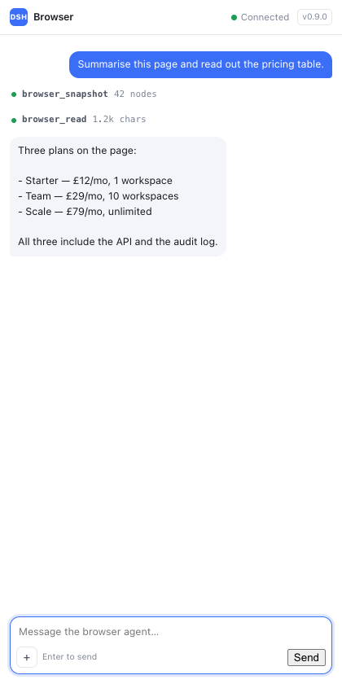

# DSH Browser Extension

[](https://github.com/rahuljaguste/dsh-browser-extension/actions/workflows/ci.yml)

A Chrome companion for [DeepSeek Harness](https://github.com/deepseek-ai/deepseek-harness):
your agent gets real `browser_*` tools over the tabs you are already logged in to,
and a side panel where you can talk to it while you browse.

No headless profile, no separate cookie jar, no cloud relay: a loopback socket
between a DSH plugin and a Chrome extension.



## What you get

- **15 browser tools** — navigate, snapshot, click, type, press, scroll, read,
  wait, screenshot, tabs, evaluate (opt-in).
- **A chat in the side panel** — a dedicated DSH Session, streamed over the
  bridge. Stop button, approvals, attachments, and history that survives an app
  restart.
- **Your browser, not a clone** — the extension acts on the tab you are looking
  at, with your sessions and logins.
- **Dependency-free Host half** — plain ESM; even the WebSocket server is 250
  lines instead of a package.

## Architecture

```
 agent ──▶ browser_navigate("…")
              │  ctx.tools
              ▼
        Host plugin ──ws://127.0.0.1:8787──▶ extension service worker
                                                     │ chrome.scripting
                                                     ▼
                                                the page (isolated world)
```

The extension dials **out** to the Host, so there is no inbound port in Chrome
and no native messaging host. The Host owns a loopback WebSocket server, pairs a
single extension instance with a token, and multiplexes commands, chat frames,
screenshots and approvals over that one socket.

| Piece | Responsibility |
|---|---|
| `index.js` | plugin entry: config, bridge, chat, tool registration |
| `lib/bridge.js` | loopback socket, pairing, request/response, pings |
| `lib/ws.js` | RFC 6455 server half (handshake, frames, fragmentation) |
| `lib/chat.js` | sidebar Session: prompts, events, approvals, policy, backfill |
| `lib/tools.js` | `browser_*` tool definitions |
| `extension/` | MV3 worker, page agent, popup, side panel |

## Requirements

- DeepSeek Harness with the Web/Desktop profile. The plugin talks to the Host
  services `sessionController`, `agents` and `sessionQuery`; those are internal
  (not a frozen public API), so pin the DSH version you test against and re-check
  after upgrades. Built and verified against DSH 0.2.1–0.2.2.
- Chrome 116+ (service-worker WebSocket keepalive; side panel API).
- Node 22+ only if you run the tests.

## Install

Not on the Chrome Web Store or npm yet: you install from source. There are two
halves — the Host plugin and the Chrome extension — and **they must be the same
version**, because pairing speaks a versioned protocol (0.9.0 uses v2).

### 1. Clone

```sh
git clone https://github.com/rahuljaguste/dsh-browser-extension
cd dsh-browser-extension
```

### 2. Install the Host plugin into a profile

If `dsh` is on your `PATH` (CLI installs):

```sh
dsh plugin --profile <profile> add link:"$PWD"
```

If you use the macOS desktop app, its CLI ships inside the bundle:

```sh
DSH="/Applications/DeepSeek Harness.app/Contents/Resources/runtime/cli/bin/dsh"
"$DSH" plugin --profile <profile> add link:"$PWD"
```

Use the profile you actually run — `desktop` for the app, or `web`. `plugin add`
records the dependency, links the checkout into the profile, and appends the
bundle to `dsh.profile.bundles` because the package declares `dsh.bundle`.
Profile layers compose at boot, so **restart the app** afterwards.

### 3. Load the extension

Open `chrome://extensions`, enable **Developer mode**, choose **Load unpacked**,
and select the `extension/` folder from the checkout. Pin it from the puzzle-piece
menu, otherwise it hides in the toolbar overflow.

Branded Chrome 137+ ignores `--load-extension`; unpacked loading is the supported
path. Chrome for Testing and Chromium still accept the flag, which is what the e2e
suite uses.

Chrome will warn that the extension can read and change all data on sites you
visit (`<all_urls>`). That is what scripting and capturing the tab you point it at
requires; [SECURITY.md](SECURITY.md) explains exactly what it can and cannot reach.

### 4. Pair

Ask the agent in DSH to run `browser_status`. It returns the port (default
`8787`) and the pairing token. Open the extension popup, paste both, **Save &
connect** — the badge turns `ON`.

The generated token is 192 bits, stored owner-only at
`<DSH_HOME>/storages/browser-companion.json`. Pairing is a per-connection
nonce/HMAC exchange, so the raw token never crosses the socket. It is a loopback
pairing secret, not an account credential; an explicit `config.token` must be at
least 16 characters.

### 5. Verify

```sh
curl -s http://127.0.0.1:8787/state
# {"bridge":"listening","connected":true,... "protocolVersion":2}
```

Then ask the agent: *"open https://example.com and summarise it"*. Tool rows
appear in the side panel as it works. If `connected` stays `false`, see
[Troubleshooting](#troubleshooting).

### Updating

```sh
cd dsh-browser-extension && git pull
```

Restart the DSH app, then click **Reload** on the extension card. Updating one
half alone breaks pairing with a protocol-mismatch or `1008` close.

### Uninstall

```sh
dsh plugin --profile <profile> remove dsh-browser-extension
```

Then **Remove** the extension in `chrome://extensions` and, if you want the saved
state gone, delete `<DSH_HOME>/browser-companion` (chat id, attachments,
screenshots).

### Moving the checkout

Chrome keys an unpacked extension to its absolute path. Moving the folder changes
the extension ID, discards its stored pairing token, and can make Chrome drop the
extension entirely. If you move it: **Load unpacked** again and re-pair.

## Using it

Talk normally. For browser work the agent will `browser_open` → `browser_snapshot`
→ `browser_click`, and the panel shows each step as it happens.

| Tool | Purpose |
|---|---|
| `browser_status` | bridge state, paired browser, port, token |
| `browser_tabs` | list tabs with ids, titles, URLs |
| `browser_open` / `browser_close` / `browser_activate` | tab lifecycle |
| `browser_navigate` | navigate the active tab (or a named one) |
| `browser_snapshot` | accessibility outline with `ref=eN` handles |
| `browser_click` / `browser_type` / `browser_press` | interaction by ref or selector |
| `browser_scroll` / `browser_read` / `browser_wait_for` | reading and waiting |
| `browser_screenshot` | PNG of the visible area, saved to disk and shown in the panel |
| `browser_evaluate` | page JS — disabled unless `allowEvaluate: true` |

Refs are rebuilt by every snapshot and die on navigation; stale refs fail with a
message telling the model to re-snapshot.

### The side panel

- One dedicated Session, created on first send and remembered in
  `<DSH_HOME>/browser-companion/chat.json`.
- **Stop** cancels the turn. **Approvals** for that Session appear as cards and
  fail closed if ignored for five minutes.
- **History** is replayed from the durable log when the panel opens, so an app
  restart does not lose the thread.
- **Attachments** — images go through DSH's attachment store; other files are
  saved verbatim and referenced by path.
- Assistant text arrives per step, not per token: only durable events are
  exposed in-process.

## Configuration

Override the bundle row in `<profile>/cordis.patch.yml`:

```yaml
- id: browser-companion
  config:
    port: 8787                  # extension popup must match
    chatCwd: ~/projects         # sidebar Session working directory (default $HOME)
    toolPolicy: no-shell        # open | no-shell | browser-only
    allowEvaluate: false        # enables browser_evaluate
    commandTimeoutMs: 45000     # per browser command
    screenshotDir: ~/Pictures/dsh
    attachmentDir: ~/dsh-attachments
```

### Tool policy

The sidebar agent inherits the profile's tools by default, including a shell. That
is a prompt-injection surface, so it is restricted per Session through
`agent.ctx.tools.restrict()`:

| Value | Denied for this Session |
|---|---|
| `no-shell` *(default)* | `bash`, `pwsh`, `write`, `edit`, `terminal` |
| `browser-only` | the above plus `read`, `read_image`, `glob`, `grep` |
| `open` | nothing — full profile powers |

`no-shell` keeps `read`, so attached files and screenshot paths still work;
`browser-only` gives up that ability to close the "read any file by path" route.
Denials apply to the sidebar Session only, never to the main chat.

## Troubleshooting

| Symptom | Cause | Fix |
|---|---|---|
| Popup: *bridge speaks protocol N* | Host and extension versions differ | Update both halves, restart the app, reload the extension |
| Popup: **close 1008** | Token does not match | Re-copy it from `browser_status` |
| Popup: **close 1006** / cannot reach `ws://127.0.0.1:8787` | App not running, or port occupied | Start the app; check `port` in the config and the popup |
| `/state` shows `"error": "Port 8787 is already in use"` | Another process owns the port | Change `port` in `cordis.patch.yml` and in the popup |
| Extension vanished or "Could not load extension" | The checkout moved | Load unpacked again from the new path, re-pair |
| Panel: *The Harness did not answer* | Host predates the chat channel | Restart the app, then reload the extension |
| Tools missing in an open chat | Profile loaded before the plugin | Restart the app and start a new chat |

Service-worker console (the only place extension stack traces appear):
`chrome://extensions` → DSH Browser Extension → **service worker**.

## Security

Short version: loopback only, token-authenticated, `chrome-extension://` origins
only, owner-only state files, no credential access in the plugin, and a
configurable tool policy for the sidebar agent. The details — threat model,
permissions, data at rest, and the limitations worth knowing before you install a
privileged extension — are in [SECURITY.md](SECURITY.md).

## Development

```sh
npm install
npm run check        # syntax-check every source file
npm run test:unit    # chat, bridge + tool tests, no browser
npm run test:e2e     # real Chromium + real extension + real bridge
```

The e2e suite uses Playwright's Chromium (branded Chrome cannot load unpacked
extensions from the command line):

```sh
PLAYWRIGHT_BROWSERS_PATH=../.pw-browsers \
  node node_modules/playwright-core/cli.js install chromium
```

See [CONTRIBUTING.md](CONTRIBUTING.md) for layout, style and PR expectations.

## Limitations

- Screenshots are viewport-only (`captureVisibleTab`); scroll and stitch for more.
- `chrome://`, `file://`, the Web Store, other extensions' pages and iframes are
  out of scope.
- One browser at a time; a second connection replaces the first.
- `browser_press` dispatches synthetic key events, which some handlers ignore.
- `browser_evaluate` evaluates an expression in the page's main world, so a page
  CSP that forbids `eval` also refuses it.
- Assistant replies are per-step, not streamed token by token.
- Single thread per profile; no model picker.

## License

[MIT](LICENSE)
